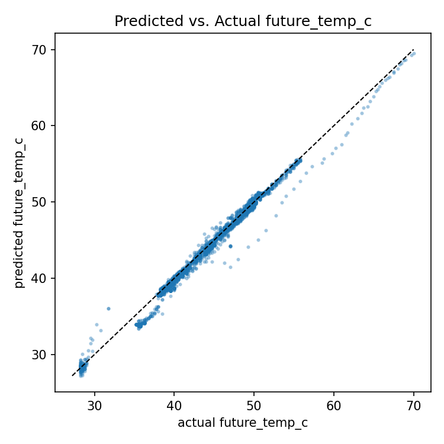

# Analog-PWM & DNN-Based Processor Cooling System

An ESP32-based fan-control system that drives a DC cooling fan with a PWM signal and compares three controllers on the same hardware: a **fixed PWM** baseline, a **rule-based** temperature curve, and a **small neural network (ANN)** that predicts future processor temperature, thermal risk and a PWM duty. The ANN is trained offline on the public [BMCDATA](https://github.com/arealuser/bmcdata) dataset, quantized to INT8 and run on the ESP32 with TensorFlow Lite Micro. A Streamlit dashboard shows live logs and compares the controllers.


## Highlights

- **Analog power stage:** the ESP32 drives an IRLZ44N low-side MOSFET with a 20 kHz, 8-bit PWM signal. A flyback diode, a gate resistor and a gate-to-ground pull-down protect and bias the stage.
- **Sensing:** two DS18B20 sensors (processor and ambient). An optional INA219 measures fan voltage, current and power; it is disabled in the current build (`USE_INA219 0`).
- **DNN model:** a 4 → 32 → 32 → 16 → 16 → 8 → 3 network.
  - Inputs: processor temperature, dT/dt, inlet (ambient) temperature and CPU usage.
  - Outputs: future temperature, thermal-risk score and PWM %.
  - Trained in Keras, fine-tuned with quantization-aware training, exported as an INT8 `.tflite` model (about 9 KB) and as a C array for the firmware.
- **Three control modes**, selected with `ACTIVE_CONTROL_MODE` in `firmware/src/config.h`: `CONTROL_ANN`, `CONTROL_FIXED_PWM`, `CONTROL_RULE_BASED`.
- **Dashboard:** a Streamlit app with a live monitor (serial port, demo or saved log), a controller-comparison tab and a model-performance tab.

## Repository Layout

```
Analog-Pwm & Dnn Based processor cooling system/
├── block diagrams/                          Flow chart, hardware block diagram, NN architecture
├── Hardware circuit/                        Photo of the hardware assembly
├── pwm_based_processor_cooling_system_v2/   Main project (current version)
│   ├── firmware/                            PlatformIO project for ESP32-WROOM-32
│   │   ├── platformio.ini
│   │   └── src/                             config, sensors, fan_control, workload,
│   │                                        tflite_inference, rule_based_control, logger, main
│   ├── python/                              Data pipeline, training, QAT, TFLite export, plots
│   ├── dashboard/                           Streamlit dashboard + sample logs
│   ├── trained_models/                      Trained models and scaler parameters
│   ├── plots/                               Evaluation plots
│   ├── FAN_FIX_NOTES.md                     Why the fan did not spin, and the fixes
│   └── README.md                            Detailed technical notes
├── Dashboard simulation v1/                 Earlier snapshot of the project (same code, no dashboard folder)
└── results/
    ├── Hardware/                            3D working circuit, circuit schematic
    └── plottings/                           Result plots
```

## Hardware

| Part | Role |
|---|---|
| ESP32-WROOM-32 DevKit V1 | Controller, runs the model |
| DS18B20 × 2 (4.7 kΩ pull-up) | Processor and ambient temperature |
| DC brushless fan + 12 V supply | Cooling load |
| IRLZ44N N-MOSFET | Low-side PWM switch |
| 1N5819 diode | Flyback protection across the fan |
| Gate resistor and 10 kΩ pull-down | Gate drive and safe boot state |
| INA219 (optional) | Fan power measurement |

**Pin map (from `firmware/src/config.h`):** DS18B20 bus on GPIO 4, fan MOSFET gate on GPIO 25, status LED on GPIO 2, INA219 on I2C GPIO 21/22 when enabled.

> **Check your wiring against the firmware.** The block diagram image shows the sensors on GPIO 4 and 5 and the fan gate on GPIO 18/27. The firmware uses a single 1-Wire bus on GPIO 4 and GPIO 25 for the fan. Treat `config.h` as the source of truth, or update one of the two so they agree.

A common ground between the ESP32 and the fan supply is required. See `FAN_FIX_NOTES.md` for the full wiring checklist and a 2-minute bench test.

## Getting Started

### 1. Train the model (optional, a trained model is already included)

```bash
git clone https://github.com/arealuser/bmcdata.git
cd pwm_based_processor_cooling_system_v2/python
pip install -r requirements.txt

python data_pipeline.py --data-dir ../../bmcdata/data --inventory bmcdata_inventory.csv --out-dir data/processed
python train.py        --data-dir data/processed --out-dir models
python qat.py          --data-dir data/processed --models-dir models
python convert_tflite.py --data-dir data/processed --models-dir models
```

Use `--limit 15` on `data_pipeline.py` for a quick test on a subset. After training, copy `model_data.h` / `model_data.cc` into `firmware/src/` and copy the `mean`/`scale` values from `scaler_params.json` into `tflite_inference.cpp`.

### 2. Flash the firmware

1. Open `pwm_based_processor_cooling_system_v2/firmware` in PlatformIO (VS Code).
2. Set `DISCOVER_ADDRESSES 1` in `config.h`, flash once, and copy the two printed DS18B20 ROM codes into `ADDR_PROCESSOR_SENSOR` and `ADDR_AMBIENT_SENSOR`. Then set it back to `0`.
3. Choose `ACTIVE_CONTROL_MODE` and, if needed, `WORKLOAD_LEVEL`.
4. Build and upload, then open the serial monitor at 115200 baud. With `FAN_TEST_ON_BOOT 1` the fan runs a 0 → 100 % sweep at start-up so you can check the wiring.

To log ANN predictions, uncomment the TensorFlow Lite library line in `platformio.ini`. Without it the ANN compiles out (`ann_valid=0`).

### 3. Run the dashboard

```bash
cd pwm_based_processor_cooling_system_v2/dashboard
pip install -r requirements.txt
streamlit run app.py
```

Open http://localhost:8501. Use *Demo (simulated)* to try it without the board. To record a real run, close the PlatformIO serial monitor first, because only one program can hold the serial port.

## Results

Test-set MAE of the INT8 model, trained on 122 of 124 inventoried BMCDATA files:

| Output | Test MAE | Reliable? |
|---|---|---|
| `future_temp_c` | 0.57 °C | Yes |
| `thermal_risk_score` (0–1) | 0.05 | Reasonable |
| `pwm_pct` | 12.4 percentage points | **No** |



More plots (workload vs temperature, dT/dt vs PWM, fan-mode breakdown, PWM and risk predictions) are in `results/plottings/`.

## Known Limitations

- **The PWM output of the ANN is not reliable.** BMCDATA contains only four distinct directly observed PWM levels, so the PWM head cannot learn a general mapping. The default controller is therefore `CONTROL_RULE_BASED`. The ANN still runs every tick, so the future-temperature and thermal-risk predictions are logged for monitoring.
- **The INT8 PWM output is coarse.** The three outputs share one quantization scale (about 0.222), so PWM comes out in steps of about 22 % and reads 0 % below roughly 50 °C. `FAN_FIX_NOTES.md` describes the fix: export the three heads as separate outputs.
- **The workload is a proxy.** The ESP32 has no real CPU utilization to read, so a busy-loop duty fraction (20 / 55 / 90 %) stands in for the dataset's `cpu_usage`. The hardware validates the control logic, not server-scale thermal behaviour.
- **`THERMAL_LIMIT_C` (85 °C)** must match in `config.h` and `python/data_pipeline.py`, or the risk score loses its meaning.
- **Quantization-aware training can hurt accuracy.** At the original learning rate it degraded the thermal-risk head. Check all three heads after QAT.
- **Fan power is estimated, not measured,** when the INA219 is not fitted. Build a power-vs-PWM table with a multimeter.

## Tools and Libraries

ESP32 Arduino framework, PlatformIO, TensorFlow / `tf_keras`, TensorFlow Model Optimization (QAT), TensorFlow Lite Micro, pandas, NumPy, scikit-learn, Matplotlib, Streamlit, Plotly, PySerial, DallasTemperature, OneWire, Adafruit INA219.

## Acknowledgements

Training data: BMCDATA (DOI 10.21227/6yep-by05, IEEE DataPort).

## License

Not specified.
